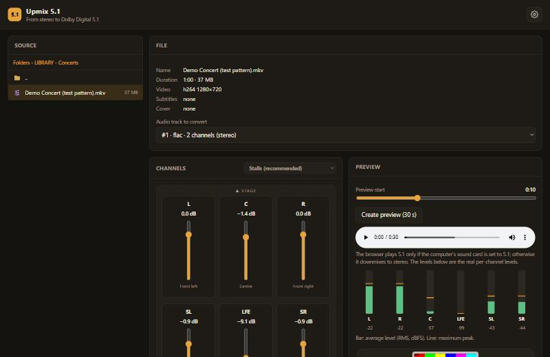

<p align="center">
  
</p>

<h1 align="center">Upmix51</h1>

<p align="center"><b>Stereo → AC-3 (Dolby Digital) 5.1 upmix · self-hosted web interface</b></p>

<p align="center"><b>English</b> · <a href="#it">Italiano</a> · <a href="#fr">Français</a> · <a href="#es">Español</a> · <a href="#de">Deutsch</a></p>



<a id="en"></a>
## 🇬🇧 English

**A self-hosted web interface to turn stereo audio tracks into AC-3 (Dolby Digital) 5.1 — without touching the video.**

Built for concert videos, DVD rips and music collections on a home server (NAS, OpenMediaVault, Unraid, any Docker host). Upmix51 copies video, subtitles and chapters untouched and adds a 5.1 track created from the original stereo: the music in front of you, the hall ambience around you, as if you were sitting in the stalls.

> **Disclaimer.** Upmix51 is an independent project, **not affiliated with Dolby Laboratories**. Dolby and Dolby Digital are trademarks of Dolby Laboratories. The software is provided "as is", without warranty: **always keep a backup of your files**. Read [LEGAL.md](LEGAL.md).

### Features
- Spatial upmix with FFmpeg's `surround` filter: clearly located sounds stay in front; reverb and applause go to the surrounds.
- Per-channel sliders (L, C, R, SL, SR, LFE), presets, advanced settings, and a top-down room view with live levels and a video frame on the TV.
- 30-second preview with real per-channel level meters.
- Cover art search (iTunes, Deezer, MusicBrainz, optional TMDB) or upload; embedded in MKV/MP4.
- Safe by design: read-only library, every result verified, overwriting off by default with confirmation and backup.
- 5 languages, light and dark theme. Only Python standard library + FFmpeg.

### Requirements
- A computer or NAS with **Docker** and **Docker Compose** (x86-64 or ARM64).
- About 300 MB of disk space for the image.

### Installation
1. Download the project:
   ```bash
   git clone https://github.com/Pietrogramma/upmix51-webui.git
   cd upmix51-webui
   ```
   (or download the ZIP from GitHub and extract it).
2. Create your configuration file:
   ```bash
   cp docker-compose.example.yml docker-compose.yml
   ```
3. Edit `docker-compose.yml` and replace the three `/path/to/...` with your folders:
   - `/path/to/your/media` → your media library (mounted **read-only**);
   - `/path/to/upmix51/output` → where converted files are saved;
   - `/path/to/upmix51/config` → settings, presets and log.
4. Build and start:
   ```bash
   docker compose up -d --build
   ```
5. Open `http://<your-server-address>:8765` in a browser.

**Update:** `git pull`, then `docker compose up -d --build`.

### Installation on OpenMediaVault (omv-compose plugin)
1. Create a folder in a shared folder, e.g. `appdata/upmix51`, and copy the whole project into it.
2. Open `docker-compose.example.yml` and use **absolute paths**: `build: /srv/dev-disk-by-uuid-…/appdata/upmix51` and the same style for the volumes.
3. In OMV go to *Services → Compose → Files → Add*, name it `upmix51`, paste the edited content and save.
4. Select it and press **Up** (the first build takes a few minutes).
5. Open `http://<nas-address>:8765`.

### Configuration

| Variable | Default | Description |
|---|---|---|
| `ROOTS` | `LIBRARY=/mnt/library:ro;OUTPUT=/mnt/output` | Folders shown in the UI: `Name=/path[:ro]`, separated by `;`. `:ro` = read-only for the program too. |
| `THREADS` | `2` | FFmpeg threads per conversion. |
| `PASSWORD` | *(empty)* | If set, the UI asks for it (any user name). Recommended. |
| `UA_CONTACT` | *(project URL)* | URL or e-mail sent to MusicBrainz to identify the application, as its API rules require. |
| `TMDB_API_KEY` | *(empty)* | Optional free themoviedb.org key to also search film posters. |
| `BACKUP_NAME` | `upmix_originali` | Backup folder used before a file is overwritten. |
| `PORT` | `8765` | HTTP port. |

### Keeping your library safe
Mount the library with `:ro` and let Upmix51 write only to the output folder: the operating system then blocks any write to the library. For in-place overwriting, mount **only the folder you need** read-write as a separate root and enable *Allow overwriting* in the settings (⚙). **Do not expose Upmix51 to the internet**; set `PASSWORD` if others use your network.

### Legal
Licence [MIT](LICENSE) · trademarks, cover art, online services: [LEGAL.md](LEGAL.md) · third-party software (FFmpeg is GPL in the built image): [THIRD_PARTY_NOTICES.md](THIRD_PARTY_NOTICES.md). Use Upmix51 only on media you are entitled to process; use cover art for your personal collection only.

---

<a id="it"></a>
## 🇮🇹 Italiano

**Un'interfaccia web da installare sul proprio server per trasformare tracce audio stereo in AC-3 (Dolby Digital) 5.1, senza toccare il video.**

Pensata per video di concerti, rip di DVD e collezioni musicali su un server domestico (NAS, OpenMediaVault, Unraid, qualsiasi host Docker). Upmix51 copia video, sottotitoli e capitoli senza modificarli e aggiunge una traccia 5.1 ricavata dallo stereo originale: la musica davanti a te, l'ambienza della sala intorno, come seduti in platea.

> **Avvertenza.** Upmix51 è un progetto indipendente, **non affiliato a Dolby Laboratories**. Dolby e Dolby Digital sono marchi di Dolby Laboratories. Il software è fornito "così com'è", senza garanzia: **tieni sempre una copia di backup dei tuoi file**. Leggi [LEGAL.md](LEGAL.md).

### Funzioni
- Upmix spaziale con il filtro `surround` di FFmpeg: i suoni localizzati restano davanti, riverbero e applausi vanno ai surround.
- Slider per ogni canale (L, C, R, SL, SR, LFE), preset, regolazioni avanzate e pianta della stanza con i livelli in tempo reale e un fotogramma del video sulla TV.
- Anteprima di 30 secondi con indicatori di livello reali per ogni canale.
- Ricerca copertine (iTunes, Deezer, MusicBrainz, TMDB facoltativo) o caricamento dal PC; inserite nei file MKV/MP4.
- Sicuro per costruzione: libreria in sola lettura, verifica di ogni risultato, sovrascrittura disattivata di default, con conferma e backup.
- 5 lingue, tema chiaro e scuro. Solo libreria standard di Python e FFmpeg.

### Requisiti
- Un computer o un NAS con **Docker** e **Docker Compose** (x86-64 o ARM64).
- Circa 300 MB di spazio per l'immagine.

### Installazione
1. Scarica il progetto:
   ```bash
   git clone https://github.com/Pietrogramma/upmix51-webui.git
   cd upmix51-webui
   ```
   (oppure scarica lo ZIP da GitHub ed estrailo).
2. Crea il tuo file di configurazione:
   ```bash
   cp docker-compose.example.yml docker-compose.yml
   ```
3. Modifica `docker-compose.yml` sostituendo i tre `/path/to/...` con le tue cartelle:
   - `/path/to/your/media` → la tua libreria (montata in **sola lettura**);
   - `/path/to/upmix51/output` → dove vengono salvati i file convertiti;
   - `/path/to/upmix51/config` → impostazioni, preset e registro.
4. Costruisci e avvia:
   ```bash
   docker compose up -d --build
   ```
5. Apri `http://<indirizzo-del-server>:8765` nel browser.

**Aggiornamento:** `git pull`, poi `docker compose up -d --build`.

### Installazione su OpenMediaVault (plugin omv-compose)
1. Crea una cartella in una cartella condivisa, per esempio `appdata/upmix51`, e copiaci tutto il progetto.
2. Apri `docker-compose.example.yml` e usa **percorsi assoluti**: `build: /srv/dev-disk-by-uuid-…/appdata/upmix51` e lo stesso stile per i volumi.
3. In OMV vai su *Servizi → Compose → File → Aggiungi*, chiamalo `upmix51`, incolla il contenuto modificato e salva.
4. Selezionalo e premi **Up** (la prima costruzione richiede alcuni minuti).
5. Apri `http://<indirizzo-del-nas>:8765`.

### Configurazione

| Variabile | Predefinito | Descrizione |
|---|---|---|
| `ROOTS` | `LIBRARY=/mnt/library:ro;OUTPUT=/mnt/output` | Cartelle mostrate nell'interfaccia: `Nome=/percorso[:ro]`, separate da `;`. `:ro` = sola lettura anche per il programma. |
| `THREADS` | `2` | Thread di FFmpeg per conversione. |
| `PASSWORD` | *(vuoto)* | Se impostata, l'interfaccia la richiede (utente qualsiasi). Consigliata. |
| `UA_CONTACT` | *(URL del progetto)* | URL o e-mail inviati a MusicBrainz per identificare l'applicazione, come richiesto dalle sue regole. |
| `TMDB_API_KEY` | *(vuoto)* | Chiave gratuita facoltativa di themoviedb.org per cercare anche le locandine dei film. |
| `BACKUP_NAME` | `upmix_originali` | Cartella di backup usata prima di sovrascrivere un file. |
| `PORT` | `8765` | Porta HTTP. |

### Proteggere la libreria
Monta la libreria con `:ro` e lascia scrivere Upmix51 solo nella cartella di uscita: il sistema operativo impedisce qualsiasi scrittura sulla libreria. Per la sovrascrittura "sul posto" monta in scrittura **solo la cartella che ti serve**, come radice separata, e attiva *Consenti la sovrascrittura* nelle impostazioni (⚙). **Non esporre Upmix51 su internet**; imposta `PASSWORD` se altri usano la tua rete.

### Note legali
Licenza [MIT](LICENSE) · marchi, copertine, servizi online: [LEGAL.md](LEGAL.md) · software di terze parti (FFmpeg è GPL nell'immagine costruita): [THIRD_PARTY_NOTICES.md](THIRD_PARTY_NOTICES.md). Usa Upmix51 solo su contenuti che hai il diritto di elaborare; usa le copertine solo per la tua collezione personale.

---

<a id="fr"></a>
## 🇫🇷 Français

**Une interface web à installer sur votre propre serveur pour transformer des pistes audio stéréo en AC-3 (Dolby Digital) 5.1, sans toucher à la vidéo.**

Conçue pour les vidéos de concerts, les rips de DVD et les collections musicales sur un serveur domestique (NAS, OpenMediaVault, Unraid, tout hôte Docker). Upmix51 copie la vidéo, les sous-titres et les chapitres sans les modifier et ajoute une piste 5.1 créée à partir de la stéréo d'origine : la musique devant vous, l'ambiance de la salle autour, comme assis au parterre.

> **Avertissement.** Upmix51 est un projet indépendant, **non affilié à Dolby Laboratories**. Dolby et Dolby Digital sont des marques de Dolby Laboratories. Le logiciel est fourni « tel quel », sans garantie : **conservez toujours une sauvegarde de vos fichiers**. Lisez [LEGAL.md](LEGAL.md).

### Fonctionnalités
- Upmix spatial avec le filtre `surround` de FFmpeg : les sons bien localisés restent devant ; la réverbération et les applaudissements vont aux surround.
- Curseurs par canal (L, C, R, SL, SR, LFE), préréglages, réglages avancés et plan de la pièce avec les niveaux en temps réel et une image de la vidéo sur la TV.
- Aperçu de 30 secondes avec de vrais indicateurs de niveau par canal.
- Recherche de pochettes (iTunes, Deezer, MusicBrainz, TMDB en option) ou import ; intégrées aux fichiers MKV/MP4.
- Sûr par conception : bibliothèque en lecture seule, vérification de chaque résultat, écrasement désactivé par défaut, avec confirmation et sauvegarde.
- 5 langues, thème clair et sombre. Uniquement la bibliothèque standard de Python et FFmpeg.

### Prérequis
- Un ordinateur ou un NAS avec **Docker** et **Docker Compose** (x86-64 ou ARM64).
- Environ 300 Mo d'espace disque pour l'image.

### Installation
1. Téléchargez le projet :
   ```bash
   git clone https://github.com/Pietrogramma/upmix51-webui.git
   cd upmix51-webui
   ```
   (ou téléchargez le ZIP depuis GitHub et extrayez-le).
2. Créez votre fichier de configuration :
   ```bash
   cp docker-compose.example.yml docker-compose.yml
   ```
3. Modifiez `docker-compose.yml` en remplaçant les trois `/path/to/...` par vos dossiers :
   - `/path/to/your/media` → votre bibliothèque (montée en **lecture seule**) ;
   - `/path/to/upmix51/output` → où sont enregistrés les fichiers convertis ;
   - `/path/to/upmix51/config` → paramètres, préréglages et journal.
4. Construisez et démarrez :
   ```bash
   docker compose up -d --build
   ```
5. Ouvrez `http://<adresse-du-serveur>:8765` dans un navigateur.

**Mise à jour :** `git pull`, puis `docker compose up -d --build`.

### Installation sur OpenMediaVault (plugin omv-compose)
1. Créez un dossier dans un dossier partagé, par exemple `appdata/upmix51`, et copiez-y tout le projet.
2. Ouvrez `docker-compose.example.yml` et utilisez des **chemins absolus** : `build: /srv/dev-disk-by-uuid-…/appdata/upmix51` et le même style pour les volumes.
3. Dans OMV, allez dans *Services → Compose → Files → Add*, nommez-le `upmix51`, collez le contenu modifié et enregistrez.
4. Sélectionnez-le et cliquez sur **Up** (la première construction prend quelques minutes).
5. Ouvrez `http://<adresse-du-nas>:8765`.

### Configuration

| Variable | Défaut | Description |
|---|---|---|
| `ROOTS` | `LIBRARY=/mnt/library:ro;OUTPUT=/mnt/output` | Dossiers affichés : `Nom=/chemin[:ro]`, séparés par `;`. `:ro` = lecture seule aussi pour le programme. |
| `THREADS` | `2` | Threads FFmpeg par conversion. |
| `PASSWORD` | *(vide)* | Si défini, l'interface le demande (nom d'utilisateur quelconque). Recommandé. |
| `UA_CONTACT` | *(URL du projet)* | URL ou e-mail envoyé à MusicBrainz pour identifier l'application, comme l'exigent ses règles. |
| `TMDB_API_KEY` | *(vide)* | Clé gratuite facultative de themoviedb.org pour chercher aussi les affiches de films. |
| `BACKUP_NAME` | `upmix_originali` | Dossier de sauvegarde utilisé avant d'écraser un fichier. |
| `PORT` | `8765` | Port HTTP. |

### Protéger votre bibliothèque
Montez la bibliothèque avec `:ro` et laissez Upmix51 écrire uniquement dans le dossier de sortie : le système d'exploitation bloque alors toute écriture dans la bibliothèque. Pour l'écrasement sur place, montez en écriture **uniquement le dossier nécessaire**, comme racine séparée, et activez *Autoriser l'écrasement* dans les paramètres (⚙). **N'exposez pas Upmix51 sur Internet** ; définissez `PASSWORD` si d'autres personnes utilisent votre réseau.

### Mentions légales
Licence [MIT](LICENSE) · marques, pochettes, services en ligne : [LEGAL.md](LEGAL.md) · logiciels tiers (FFmpeg est sous GPL dans l'image construite) : [THIRD_PARTY_NOTICES.md](THIRD_PARTY_NOTICES.md). N'utilisez Upmix51 que sur des contenus que vous avez le droit de traiter ; utilisez les pochettes uniquement pour votre collection personnelle.

---

<a id="es"></a>
## 🇪🇸 Español

**Una interfaz web para instalar en tu propio servidor que convierte pistas de audio estéreo en AC-3 (Dolby Digital) 5.1, sin tocar el vídeo.**

Pensada para vídeos de conciertos, copias de DVD y colecciones musicales en un servidor doméstico (NAS, OpenMediaVault, Unraid, cualquier host Docker). Upmix51 copia el vídeo, los subtítulos y los capítulos sin modificarlos y añade una pista 5.1 creada a partir del estéreo original: la música delante de ti y el ambiente de la sala a tu alrededor, como sentado en la platea.

> **Aviso.** Upmix51 es un proyecto independiente, **no afiliado a Dolby Laboratories**. Dolby y Dolby Digital son marcas de Dolby Laboratories. El software se proporciona «tal cual», sin garantía: **guarda siempre una copia de seguridad de tus archivos**. Lee [LEGAL.md](LEGAL.md).

### Funciones
- Upmix espacial con el filtro `surround` de FFmpeg: los sonidos bien localizados se quedan delante; la reverberación y los aplausos van a los surround.
- Deslizadores por canal (L, C, R, SL, SR, LFE), preajustes, ajustes avanzados y plano de la sala con los niveles en tiempo real y un fotograma del vídeo en la TV.
- Vista previa de 30 segundos con medidores de nivel reales por canal.
- Búsqueda de carátulas (iTunes, Deezer, MusicBrainz, TMDB opcional) o subida desde el ordenador; incrustadas en archivos MKV/MP4.
- Seguro por diseño: biblioteca de solo lectura, cada resultado se verifica, sobrescritura desactivada por defecto, con confirmación y copia de seguridad.
- 5 idiomas, tema claro y oscuro. Solo la biblioteca estándar de Python y FFmpeg.

### Requisitos
- Un ordenador o NAS con **Docker** y **Docker Compose** (x86-64 o ARM64).
- Unos 300 MB de espacio en disco para la imagen.

### Instalación
1. Descarga el proyecto:
   ```bash
   git clone https://github.com/Pietrogramma/upmix51-webui.git
   cd upmix51-webui
   ```
   (o descarga el ZIP desde GitHub y descomprímelo).
2. Crea tu archivo de configuración:
   ```bash
   cp docker-compose.example.yml docker-compose.yml
   ```
3. Edita `docker-compose.yml` y sustituye los tres `/path/to/...` por tus carpetas:
   - `/path/to/your/media` → tu biblioteca (montada en **solo lectura**);
   - `/path/to/upmix51/output` → dónde se guardan los archivos convertidos;
   - `/path/to/upmix51/config` → ajustes, preajustes y registro.
4. Construye e inicia:
   ```bash
   docker compose up -d --build
   ```
5. Abre `http://<dirección-del-servidor>:8765` en el navegador.

**Actualización:** `git pull` y después `docker compose up -d --build`.

### Instalación en OpenMediaVault (plugin omv-compose)
1. Crea una carpeta dentro de una carpeta compartida, por ejemplo `appdata/upmix51`, y copia en ella todo el proyecto.
2. Abre `docker-compose.example.yml` y usa **rutas absolutas**: `build: /srv/dev-disk-by-uuid-…/appdata/upmix51` y el mismo estilo para los volúmenes.
3. En OMV ve a *Services → Compose → Files → Add*, llámalo `upmix51`, pega el contenido modificado y guarda.
4. Selecciónalo y pulsa **Up** (la primera construcción tarda unos minutos).
5. Abre `http://<dirección-del-nas>:8765`.

### Configuración

| Variable | Por defecto | Descripción |
|---|---|---|
| `ROOTS` | `LIBRARY=/mnt/library:ro;OUTPUT=/mnt/output` | Carpetas mostradas: `Nombre=/ruta[:ro]`, separadas por `;`. `:ro` = solo lectura también para el programa. |
| `THREADS` | `2` | Hilos de FFmpeg por conversión. |
| `PASSWORD` | *(vacío)* | Si se define, la interfaz la pide (cualquier nombre de usuario). Recomendado. |
| `UA_CONTACT` | *(URL del proyecto)* | URL o e-mail enviado a MusicBrainz para identificar la aplicación, como exigen sus normas. |
| `TMDB_API_KEY` | *(vacío)* | Clave gratuita opcional de themoviedb.org para buscar también carteles de películas. |
| `BACKUP_NAME` | `upmix_originali` | Carpeta de copia de seguridad usada antes de sobrescribir un archivo. |
| `PORT` | `8765` | Puerto HTTP. |

### Proteger tu biblioteca
Monta la biblioteca con `:ro` y deja que Upmix51 escriba solo en la carpeta de salida: así el sistema operativo bloquea cualquier escritura en la biblioteca. Para sobrescribir en el sitio, monta con escritura **solo la carpeta que necesites**, como raíz separada, y activa *Permitir sobrescribir* en los ajustes (⚙). **No expongas Upmix51 a internet**; define `PASSWORD` si otras personas usan tu red.

### Aviso legal
Licencia [MIT](LICENSE) · marcas, carátulas, servicios en línea: [LEGAL.md](LEGAL.md) · software de terceros (FFmpeg es GPL en la imagen construida): [THIRD_PARTY_NOTICES.md](THIRD_PARTY_NOTICES.md). Usa Upmix51 solo con contenidos que tengas derecho a procesar; usa las carátulas solo para tu colección personal.

---

<a id="de"></a>
## 🇩🇪 Deutsch

**Eine selbst gehostete Weboberfläche, die Stereo-Audiospuren in AC-3 (Dolby Digital) 5.1 umwandelt – ohne das Video anzutasten.**

Gedacht für Konzertvideos, DVD-Rips und Musiksammlungen auf einem Heimserver (NAS, OpenMediaVault, Unraid, jeder Docker-Host). Upmix51 übernimmt Video, Untertitel und Kapitel unverändert und fügt eine aus dem Original-Stereo erzeugte 5.1-Spur hinzu: die Musik vor dir, die Saalatmosphäre um dich herum – wie im Parkett.

> **Hinweis.** Upmix51 ist ein unabhängiges Projekt und **nicht mit Dolby Laboratories verbunden**. Dolby und Dolby Digital sind Marken von Dolby Laboratories. Die Software wird „wie besehen“ ohne Gewährleistung bereitgestellt: **bewahre immer eine Sicherung deiner Dateien auf**. Lies [LEGAL.md](LEGAL.md).

### Funktionen
- Räumliches Upmix mit dem FFmpeg-Filter `surround`: klar ortbare Klänge bleiben vorne, Nachhall und Applaus gehen auf die Surround-Kanäle.
- Regler pro Kanal (L, C, R, SL, SR, LFE), Voreinstellungen, erweiterte Einstellungen und ein Raumplan mit Live-Pegeln und einem Videobild auf dem Fernseher.
- 30-Sekunden-Vorschau mit echten Pegelanzeigen pro Kanal.
- Cover-Suche (iTunes, Deezer, MusicBrainz, optional TMDB) oder eigenes Bild hochladen; eingebettet in MKV/MP4.
- Sicher durch Konzept: schreibgeschützte Bibliothek, jedes Ergebnis wird geprüft, Überschreiben standardmäßig aus, mit Bestätigung und Sicherung.
- 5 Sprachen, helles und dunkles Design. Nur Python-Standardbibliothek und FFmpeg.

### Voraussetzungen
- Ein Computer oder NAS mit **Docker** und **Docker Compose** (x86-64 oder ARM64).
- Etwa 300 MB Speicherplatz für das Image.

### Installation
1. Projekt herunterladen:
   ```bash
   git clone https://github.com/Pietrogramma/upmix51-webui.git
   cd upmix51-webui
   ```
   (oder das ZIP von GitHub herunterladen und entpacken).
2. Eigene Konfigurationsdatei anlegen:
   ```bash
   cp docker-compose.example.yml docker-compose.yml
   ```
3. `docker-compose.yml` bearbeiten und die drei `/path/to/...` durch deine Ordner ersetzen:
   - `/path/to/your/media` → deine Bibliothek (**schreibgeschützt** eingebunden);
   - `/path/to/upmix51/output` → hier werden die konvertierten Dateien gespeichert;
   - `/path/to/upmix51/config` → Einstellungen, Voreinstellungen und Protokoll.
4. Bauen und starten:
   ```bash
   docker compose up -d --build
   ```
5. `http://<server-adresse>:8765` im Browser öffnen.

**Aktualisieren:** `git pull`, danach `docker compose up -d --build`.

### Installation unter OpenMediaVault (Plugin omv-compose)
1. In einem freigegebenen Ordner einen Ordner anlegen, z. B. `appdata/upmix51`, und das ganze Projekt hineinkopieren.
2. `docker-compose.example.yml` öffnen und **absolute Pfade** verwenden: `build: /srv/dev-disk-by-uuid-…/appdata/upmix51` und dieselbe Schreibweise für die Volumes.
3. In OMV *Services → Compose → Files → Add* öffnen, Namen `upmix51` vergeben, den angepassten Inhalt einfügen und speichern.
4. Auswählen und **Up** drücken (der erste Build dauert einige Minuten).
5. `http://<nas-adresse>:8765` öffnen.

### Konfiguration

| Variable | Standard | Beschreibung |
|---|---|---|
| `ROOTS` | `LIBRARY=/mnt/library:ro;OUTPUT=/mnt/output` | Angezeigte Ordner: `Name=/pfad[:ro]`, getrennt durch `;`. `:ro` = auch für das Programm schreibgeschützt. |
| `THREADS` | `2` | FFmpeg-Threads pro Konvertierung. |
| `PASSWORD` | *(leer)* | Wenn gesetzt, fragt die Oberfläche danach (beliebiger Benutzername). Empfohlen. |
| `UA_CONTACT` | *(Projekt-URL)* | URL oder E-Mail, die gemäß den Regeln von MusicBrainz zur Identifizierung der Anwendung mitgesendet wird. |
| `TMDB_API_KEY` | *(leer)* | Optionaler kostenloser themoviedb.org-Schlüssel, um auch Filmplakate zu suchen. |
| `BACKUP_NAME` | `upmix_originali` | Sicherungsordner, der vor dem Überschreiben einer Datei verwendet wird. |
| `PORT` | `8765` | HTTP-Port. |

### Deine Bibliothek schützen
Binde die Bibliothek mit `:ro` ein und lass Upmix51 nur in den Ausgabeordner schreiben: Dann blockiert das Betriebssystem jeden Schreibzugriff auf die Bibliothek. Für das Überschreiben an Ort und Stelle binde **nur den benötigten Ordner** beschreibbar als eigene Wurzel ein und aktiviere *Überschreiben erlauben* in den Einstellungen (⚙). **Stelle Upmix51 nicht ins Internet**; setze `PASSWORD`, wenn andere dein Netzwerk nutzen.

### Rechtliches
Lizenz [MIT](LICENSE) · Marken, Cover, Online-Dienste: [LEGAL.md](LEGAL.md) · Software von Drittanbietern (FFmpeg steht im gebauten Image unter GPL): [THIRD_PARTY_NOTICES.md](THIRD_PARTY_NOTICES.md). Verwende Upmix51 nur für Inhalte, die du bearbeiten darfst; verwende Cover nur für deine private Sammlung.
